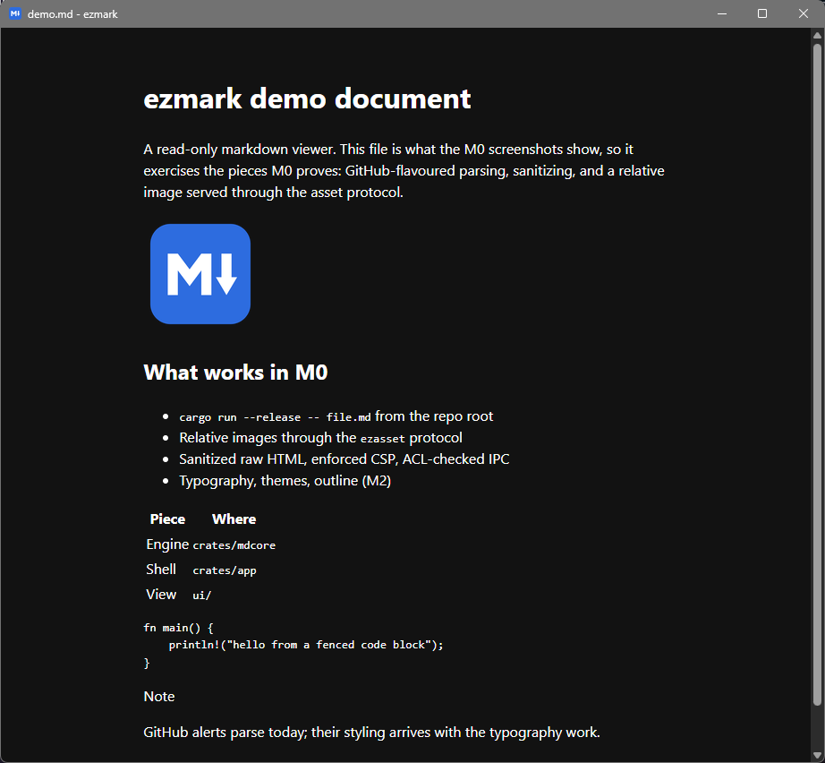

# ezmark

A fast, read-only markdown viewer for Windows 11 and macOS. Open a `.md`
file and read it. It does not edit, and it never will.

[](https://github.com/Vibin-LLC-2025/ezmark/actions/workflows/ci.yml)

> **Status: milestone M0 (spike and skeleton).** The run story, the security
> harness, and CI on both platforms work. Typography, themes, syntax
> highlighting, live reload, and navigation arrive in M1 to M3, so this is not
> a daily viewer yet. See the [plan](docs/CLONE-AND-RUN-PLAN.md) and the
> [changelog](CHANGELOG.md).



The same build on macOS: [screenshot](docs/media/m0-macos.png). What M0 has
proven, and what is still open, is in [docs/m0-evidence.md](docs/m0-evidence.md).

## Why

Developers read READMEs, specs, and AI-generated markdown locally all day. The
tools for it either edit, run scripts from the document, lose your place when
the file changes, or render differently from GitHub. ezmark aims to be:

- strictly read-only
- faithful to GitHub's rendering: alerts, footnotes, task lists, anchors
- safe with untrusted files: sanitized HTML, a strict CSP, no network
- steady while you read: live reload that keeps your place (M3)
- correct about relative links and images, however the file was opened
- small enough to read in an afternoon

## Run it

### Prerequisites

**Windows 11**

- Rust via [rustup](https://rustup.rs/), with the default MSVC target.
- Visual Studio Build Tools (standalone, not the IDE) with the MSVC C++
  build tools and a Windows SDK. On the author's machine, Build Tools 2019
  with only "MSVC v142 x64/x86 build tools" and "Windows 10 SDK 10.0.19041"
  was enough. The recommended component list and its disk cost come from a
  clean-VM rehearsal that is still to do. A restart may be needed before
  `cargo` finds the linker.
- WebView2, which Windows 11 includes.

**macOS**

- Rust via [rustup](https://rustup.rs/).
- Xcode Command Line Tools: `xcode-select --install`.
- Tested on: macOS 15 on Apple Silicon, in CI. No other version is claimed yet.

**Both:** git. Nothing else.

### One command

The first build compiles about 250 crates. It took 109 seconds on a 12-core
desktop and under 3 minutes on GitHub's Windows and macOS runners; expect
several minutes on a laptop. Later builds take seconds.

```sh
git clone https://github.com/Vibin-LLC-2025/ezmark.git
cd ezmark
cargo run --release -- path/to/file.md
```

Paths may be relative, quoted, or contain spaces and Unicode. Run it without a
file to get a window you can drop a file onto.

### Optional: build an app bundle

Not needed to read files. This produces a macOS `.app` (ad hoc signed) and a
per-user Windows installer, and its file associations are tested at release
(M5), not yet:

```sh
cargo install tauri-cli --version 2.12.4 --locked
cargo tauri build
```

## Security

ezmark treats every document as hostile. Raw HTML is sanitized in Rust, a
strict Content Security Policy allows images only from ezmark's own asset
scheme, every link click is intercepted, and file access is confined to the
document's folder or its git repository. The full contract is
[ADR 0003](docs/adr/0003-security-contract.md).

"No network" is stated at the level of the evidence: the CSP blocks remote
loads, the app code makes no network calls, and no network plugins are
enabled. The CI security harness proves that each test fixture's remote loads
are blocked by the enforced CSP and reach no listener. It cannot prove that
the system webview itself never touches the network.

Report vulnerabilities privately: see [SECURITY.md](SECURITY.md).

## Known limitations

- **Smart App Control** on Windows 11, when enabled, blocks unsigned
  executables, including ones you build yourself. ezmark does not ask you to
  change security settings; if Smart App Control is on, it will not run.
- **No Linux** in v1.
- **No Mermaid diagrams or math** in v1. Their fences show as code.
- **Remote images never load** in v1. In M0 they are removed; from M1 a
  placeholder shows the URL.
- **M0 has no styling work yet**: no syntax highlighting, themes beyond the
  system light or dark default, outline, find, or live reload.

## Scope

**Never:** editing of any kind, split view, plugins, sync, telemetry, and
DOCX, EPUB, or Pandoc export.

**Later (v1.1 or after):** Mermaid and math, opt-in remote images, print, open
in editor, reveal in Explorer or Finder, copy buttons on code blocks, tabs,
bundled fonts, a macOS Quick Look extension, an Explorer preview pane, Linux,
and signed installers with auto-update.

## Why not MDHero or Tinta?

Both are good, and if you want a viewer today, try them first. As of
2026-10-26:

- [MDHero](https://github.com/vaibhav-kakde-in/mdhero) (MIT, Tauri) is the
  closest match: viewer-first, cross-platform, live reload. Its issue queue
  is moving toward editing (undo, pasting images), footnotes do not render,
  and there is no Intel Mac build.
- [Tinta](https://github.com/oipoistar/tinta) (MIT, native C++) is a tiny,
  fast Windows-only viewer with an edit mode.

ezmark's bet is the combination: strictly read-only, GitHub-faithful,
hostile-file-safe with tests to show it, and a codebase small enough to audit.

## Development

[CONTRIBUTING.md](CONTRIBUTING.md) has the commands, including the security
harness. [ARCHITECTURE.md](ARCHITECTURE.md) is the codemap, the decisions are
in [docs/adr](docs/adr), and measured numbers are in
[docs/measurements.md](docs/measurements.md).

## License

Licensed under either of [Apache License, Version 2.0](LICENSE-APACHE) or
[MIT license](LICENSE-MIT) at your option.
